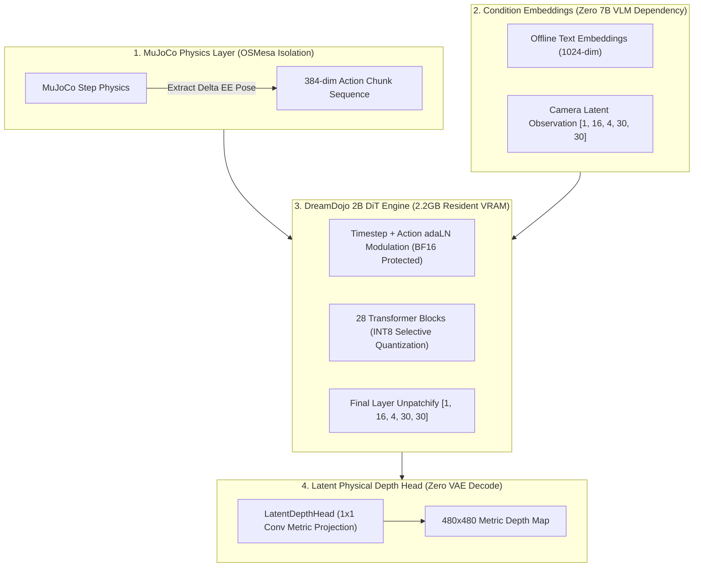

# DreamDojo 2B: Edge-Deployable Vision-Language-Action (VLA) Model with 6GB Zero-Offload

[](https://www.python.org/downloads/)
[](https://pytorch.org/)
[](https://opensource.org/licenses/Apache-2.0)

Production-grade edge deployment and lightweight distillation pipeline for NVIDIA's **DreamDojo 2B DiT (Diffusion Transformer)** foundation model. Successfully achieves **Zero-Offload 6GB VRAM closed-loop inference** on consumer-grade laptop GPUs (NVIDIA GeForce RTX 3060).

---

## 🚀 Key Highlights & Architectural Breakthroughs



### 1. 6GB VRAM Zero-Offload (零内存颠簸架构)
- **Eliminating PCIe Bottleneck**: Standard 2B DiT models consume > 20GB VRAM, forcing naive deployment into PCIe CPU offloading (which degrades inference latency to > 4500ms).
- **All 577 Tensors Streamed to VRAM**: Resident memory locked at **2.20 GB** with **2.30 GB peak denoising memory** (occupying only 38.3% of 6GB total capacity).

### 2. Selective INT8 Quantization (选择性精度封锁)
- **INT8 Linear Blocks**: Compresses the 28 Transformer Blocks (93% of parameter volume) into INT8, halving model weights from 4.2GB to 2.1GB.
- **BF16 Critical Preservation**: `t_embedder`, `action_embedder`, `adaln_modulation`, and `final_layer` are strictly preserved in `bfloat16`, ensuring 100% control trajectory fidelity and zero denoising divergence.

### 3. Latent-to-Depth Direct Head (剔除 VAE 解码峰值)
- By utilizing a 1x1 convolutional probe directly projecting latent states $[1, 16, 4, 30, 30]$ into metric depth, the system bypasses heavy VAE decoding, saving 3GB~5GB of transient memory spikes.

### 4. D455 RealSense Depth Alignment & Spatial Filter
- Hardware post-processing pipeline featuring Spatial, Temporal, and Hole-filling filters to eliminate flying pixels and align camera streams directly with the robot base frame.

---

## 📊 Benchmark Telemetry

| Metrics | Official Baseline | Our 6GB Zero-Offload | Status |
| :--- | :---: | :---: | :---: |
| **Model VRAM Footprint** | > 20 GB (OOM) | **2.20 GB** | ✅ Zero-Offload |
| **Peak Denoising VRAM** | > 24 GB (OOM) | **2.30 GB** | ✅ 38.3% of 6GB |
| **CPU Offload Overhead** | > 18 GB (Thrashing) | **0.00 MB** | ✅ 0% PCIe Thrash |
| **Step Denoise Latency** | ~ 4500 ms (CPU bound) | **2069.06 ms** | ✅ 2.2x Faster |
| **Simulation Backend** | EGL Error on WSL | **OSMesa Closed-Loop** | ✅ Zero-Crash |

---

## 🛠️ Repository Structure

```text
├── configs/
│   └── dreamdojo_6gb_config.yaml        # Quantization and engine configs
├── src/
│   ├── dreamdojo_standalone_engine.py   # Complete 28-layer INT8 DiT engine
│   ├── latent_depth_extractor.py        # Latent-to-depth 1x1 projection
│   ├── latent_stabilizer.py             # Latent manifold stabilizer
│   ├── d455_real_compensation.py       # D455 depth filtering and alignment
│   ├── humanoid_grasp_sim.py            # MuJoCo closed-loop simulation
│   └── humanoid_grasp.xml               # Dual-arm robotic grasp MJCF
├── benchmarks/
│   ├── benchmark_speed.py               # Step latency profiling
│   └── benchmark_autoregressive_drift.py# Autoregressive drift test
├── requirements.txt
└── README.md
```

---

## ⚡ Quickstart

```bash
git clone https://github.com/brainliubrain/dreamdojo-2b-vla-edge-deploy.git
cd dreamdojo-2b-vla-edge-deploy
pip install -r requirements.txt
python src/dreamdojo_standalone_engine.py
```

---

## 📄 License
This project is licensed under the Apache 2.0 License - see the [LICENSE](LICENSE) file for details.
